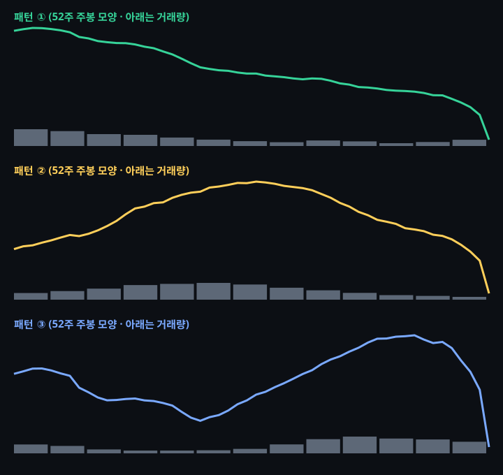

# 프랙탈(차트 모양 유사도) 검증

- 실행: 2026-11-25 16:15 · 2492종목
- 패턴 학습: 2023-11-26 이전, 이후 1년 안에 2배 이상 오른 자리 3834개의 직전 52주 모양을 3개로 묶음
- 검증: 2023-11-26 이후 4주마다 모든 종목 87,748개 시점 · 유사도 = 패턴과의 상관계수 (1에 가까울수록 닮음)

## 1. 패턴 크기
| 패턴 | 학습 사례 수 |
|---|---|
| ① | 2411 |
| ② | 759 |
| ③ | 664 |

## 2. 유사도가 높을수록 실제로 더 올랐나 (검증 기간)
| 구분 | 시점 수 | 26주 안 +30% | 26주 안 +50% | 52주 안 +100% | 26주 뒤 평균 수익 |
|---|---|---|---|---|---|
| 전체 (기준) | 87,748 | 38.9% | 23.4% | 17.2% | +1.0% |
| 유사도 하위 50% | 43,874 | 38.8% | 24.0% | 17.6% | +0.7% |
| 50~80% | 26,324 | 37.7% | 22.2% | 16.5% | +0.8% |
| 80~95% | 13,162 | 39.1% | 22.7% | 16.7% | +0.5% |
| 상위 5% | 3,510 | 45.7% | 27.3% | 19.5% | +4.9% |
| 상위 1% | 878 | 47.6% | 28.0% | 20.3% | +8.1% |

(상위 5% 기준 유사도 ≥ 0.88, 상위 1% ≥ 0.92)

## 3. 패턴별 (각 패턴과 닮은 정도 상위 5%)
| 구분 | 시점 수 | 26주 안 +30% | 26주 안 +50% | 52주 안 +100% | 26주 뒤 평균 수익 |
|---|---|---|---|---|---|
| 패턴 ① (그 패턴 유사도 ≥ 0.88) | 4,388 | 46.0% | 27.4% | 19.6% | +5.5% |
| 패턴 ② (그 패턴 유사도 ≥ 0.64) | 4,388 | 40.2% | 23.2% | 15.2% | -0.5% |
| 패턴 ③ (그 패턴 유사도 ≥ 0.62) | 4,388 | 40.8% | 24.6% | 16.4% | +3.6% |

## 4. 연도별 (유사도 상위 5% vs 전체)
| 연도 | 상위 5% 26주 +50% | 전체 26주 +50% | 상위 5% 평균 수익 | 전체 평균 수익 |
|---|---|---|---|---|
| 2023 | 12.5% | 22.4% | -4.0% | +4.6% |
| 2024 | 24.4% | 18.2% | +2.6% | -2.5% |
| 2025 | 37.1% | 32.0% | +17.1% | +12.9% |
| 2026 | 18.9% | 18.4% | -21.1% | -21.2% |

## 5. 지금 각 패턴과 가장 닮은 종목 (참고)
### 패턴 ①
| 종목 | 유사도 |
|---|---|
| 지노믹트리 (228760) | 0.95 |
| SG글로벌 (001380) | 0.94 |
| 넥스트바이오메디컬 (389650) | 0.94 |
| 아셈스 (136410) | 0.94 |
| 프레스티지바이오파마 (950210) | 0.94 |
| 일동홀딩스 (000230) | 0.94 |
| KG모빌리티플랫폼 (381970) | 0.93 |
| 아이엠비디엑스 (461030) | 0.93 |
| 알리코제약 (260660) | 0.93 |
| 젝시믹스 (337930) | 0.93 |
| 소노스퀘어 (007720) | 0.93 |
| 휴메딕스 (200670) | 0.93 |
| 에이비엘바이오 (298380) | 0.93 |
| 모델솔루션 (417970) | 0.93 |
| 지에프씨생명과학 (388610) | 0.93 |
### 패턴 ②
| 종목 | 유사도 |
|---|---|
| 삼성증권 (016360) | 0.89 |
| LS (006260) | 0.87 |
| OCI (456040) | 0.86 |
| 일지테크 (019540) | 0.86 |
| LIG디펜스앤에어로스페이스 (079550) | 0.86 |
| 싸이맥스 (160980) | 0.86 |
| 효성중공업 (298040) | 0.85 |
| 삼영전자 (005680) | 0.84 |
| 롯데쇼핑 (023530) | 0.84 |
| 제이에스링크 (127120) | 0.84 |
| SKAI (357880) | 0.84 |
| 비츠로셀 (082920) | 0.83 |
| NC (036570) | 0.83 |
| 나무AX (242040) | 0.83 |
| 두산 (000150) | 0.83 |
### 패턴 ③
| 종목 | 유사도 |
|---|---|
| 자이에스앤디 (317400) | 0.74 |
| 고스트스튜디오 (950190) | 0.72 |
| 사조씨푸드 (014710) | 0.70 |
| 서산 (079650) | 0.68 |
| 현대해상 (001450) | 0.67 |
| 금호건설 (002990) | 0.65 |
| 씨젠 (096530) | 0.64 |
| 인바디 (041830) | 0.62 |
| 유니드비티플러스 (446070) | 0.62 |
| 동양파일 (228340) | 0.61 |
| LX하우시스우 (108675) | 0.60 |
| 솔본 (035610) | 0.60 |
| 골프존홀딩스 (121440) | 0.59 |
| 이퓨쳐 (134060) | 0.59 |
| GS (078930) | 0.59 |

## 읽는 법
- 2번 표에서 **상위 5%·1%가 기준(전체)보다 확실히 높아야** 유사도가 쓸모 있는 거예요. 기준선: 26주 안 +50% 23.4%, 26주 뒤 평균 +1.0%.
- 상장폐지 종목이 빠져 있어서 숫자가 실제보다 좋게 나와요.

_계산 시간 318초_